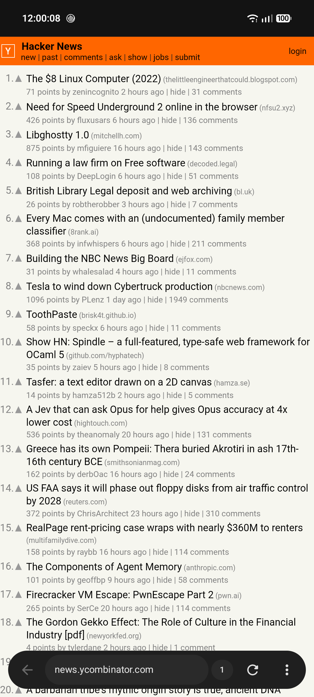
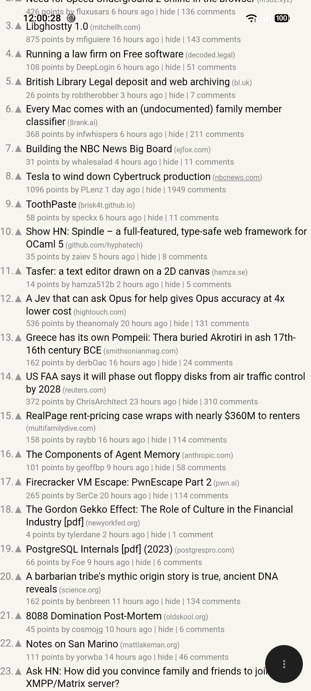
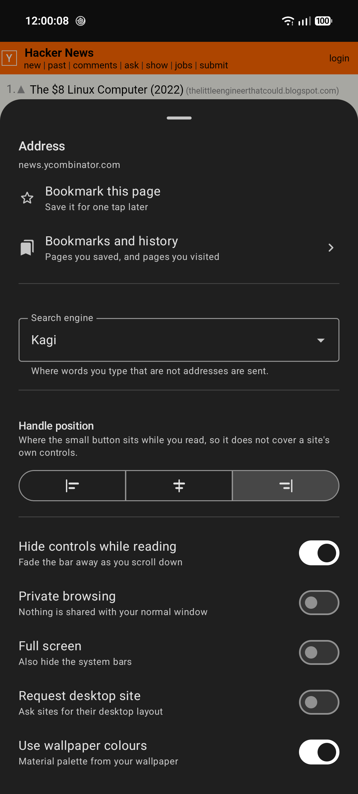
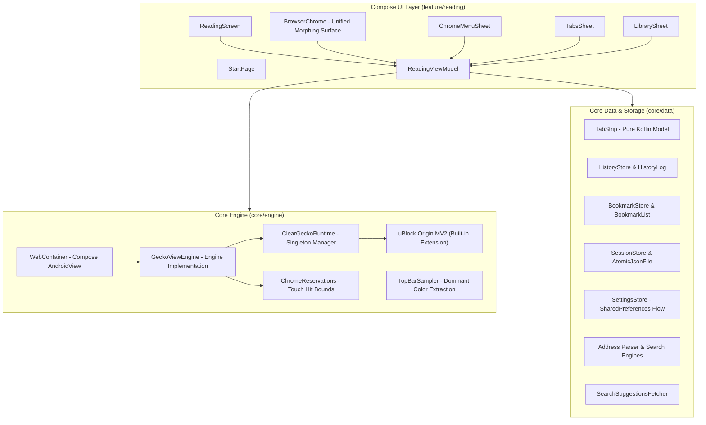

# Clear Browser

<p align="center">
  <strong>The browser that gets out of your way.</strong>
</p>

<p align="center">
  
  
  
  
  
  
  
  
</p>

---

**Clear** is an uncluttered, reading-first web browser for Android. Built with **Kotlin**, **Jetpack Compose**, **Material 3 Expressive**, and powered by **Mozilla GeckoView**, Clear bundles **uBlock Origin Manifest V2 (MV2)** to eliminate ads, trackers, and page clutter before they ever reach your screen.

The web page is the content; the chrome is just the tool. When you scroll to read, the interface gracefully retreats into a minimal handle. When you need it, one tap or upward flick brings back full navigation.

---

## Preview

<p align="center">
  
  &nbsp;&nbsp;
  
  &nbsp;&nbsp;
  
</p>
<p align="center">
  <em>Navigation Bar &nbsp;•&nbsp; Minimized Handle &nbsp;•&nbsp; Settings & Menu</em>
</p>

---

## Core Philosophy

1. **Content First, Chrome Second**  
   Modern mobile browsers occupy valuable screen real estate with persistent multi-row toolbars, shopping widgets, and recommendation tiles. Clear treats the document as the primary experience: the omnibox and navigation controls auto-hide during reading and animate into a subtle floating handle.
2. **Resource-Respecting Architecture**  
   Traditional browsers often keep dozens of `WebView` compositor instances running concurrently in the background, consuming hundreds of megabytes of RAM and draining battery. Clear maintains **only one active attached `WebView`** in the view hierarchy at a time. Inactive tabs are detached, paused, and restored on-demand.
3. **Hard Isolation for Privacy**  
   Private browsing should be a security guarantee, not a cleanup promise. Clear's Incognito mode uses Android's multi-profile engine API (`WebViewCompat.setProfile` / `MULTI_PROFILE`) to isolate cookies, cache, and storage in a dedicated memory profile. Private sessions never write to disk.
4. **Local-First & Transparent**  
   No external sync accounts, no telemetry, no tracking. History and bookmarks are stored directly on-device in atomic human-readable JSON files with atomic rename operations.

---

## Features

### Built-in Desktop-Grade Adblocking
- **uBlock Origin Manifest V2 (MV2)**: Pre-bundled and active out of the box (`uBlock0@raymondhill.net`). Blocks network requests, third-party trackers, and intrusive ad-tech scripts before bytes ever hit your device.
- **Enhanced Tracking Protection (ETP Strict)**: Native Gecko anti-tracking, query parameter stripping, and automatic third-party cookie purging.
- **Enabled in Private Browsing**: Full content blocking protection extends across both regular and private browsing sessions.

### Minimalist & Responsive Interface
- **Unified Morphing Surface**: Rather than jarringly animating separate toolbars and buttons, the omnibox dynamically morphs into an unobtrusive reveal handle and back using physics-based spring animations (`Motion.kt`).
- **Customizable Handle Position**: Dock the collapsed reveal handle to the **Left**, **Center**, or **Right** of the screen so it never covers in-page elements, chat widgets, or cookie banners.
- **Full-Bleed Viewport**: Inset-free web view eliminates layout re-calculation jitter during scrolling, locking to a smooth 120fps display pipeline.
- **Dynamic Theming**: Full Material 3 Expressive theming supporting dynamic wallpaper color extraction (Material You) and system Dark/Light themes.
- **Immersive Mode**: Fullscreen mode option to hide both system navigation and status bars for distraction-free reading.

### Adaptive Top Bar & Notch Integration
- **Dominant Header Color Extraction**: On page load, `TopBarSampler` clusters and quantizes the top region of the webpage using 5-bit color buckets. If a dominant color accounts for $\ge 50\%$ of the header (like Hacker News orange), that exact shade is chosen; otherwise, a weighted average RGB is computed.
- **Seamless Status Bar Extension**: The Android status bar area is filled with the sampled website color, blending seamlessly into the website's navigation header.
- **Notch & Cutout Safe Area**: Web content begins cleanly below the status bar, guaranteeing fixed headers, hamburger menus, and search bars are never obscured by the camera cutout or system clock.
- **Dynamic Status Bar Icon Contrast**: Relative luminance calculation ($L > 0.45$) dynamically toggles light or dark status bar icons (clock, battery, wifi) to maximize readability against any website's color palette.
- **Zero Scroll Overhead**: Sampled once on page load and locked for the duration of the page. Scrolling is 100% free of layout re-calculations, pixel copies, or compositor delays.

### Frosted Glass Aesthetics
- **Seamless Acrylic Styling**: Both the collapsed omnibox pill and the live search suggestions card share a cohesive frosted glass design language with multi-stop vertical acrylic gradients.
- **Specular Rim Highlights**: Gradient specular top rim catch borders reflect light naturally while subtle ambient and spot depth shadows elevate floating controls above the page.
- **Hairline Dividers**: Search suggestions are separated by subtle, translucent hairlines rather than opaque separator blocks.

### Privacy & Incognito
- **Context-Isolated Private Sessions**: Independent memory-only context IDs via GeckoView's private browsing architecture. Cookies, storage, and history are never written to disk.
- **Zero Disk Footprint in Incognito**: Session persistence, download history, and visit logs are completely bypassed in private mode.
- **Subtle Privacy Indicator**: An unobtrusive Material `VisibilityOff` glyph in the address bar confirms private mode without consuming horizontal bar space.
- **Lifecycle Resilience**: Private mode survives Activity configuration changes (screen rotations, font changes) without leaking tabs to the standard profile, but resets completely on application finish.

### Efficient Tab Strip
- **Lazy Engine Allocation**: Tabs restored from previous sessions remain URLs until activated, saving memory and startup latency.
- **Tab Strip Management**: Fast bottom sheet with open tab counts, active tab indicators, single-tap switching, and per-tab closing.
- **Persistent Sessions**: Active tabs, history state, and scroll offsets are saved atomically on app backgrounding, with state bundles preserved across process death.

### Search & Navigation
- **Live Search Suggestions**: Instant debounced query suggestions with local bookmark and history matching. Easily append suggestions directly into the omnibox via `↖`.
- **Kagi by Default**: Ships with privacy-first [Kagi](https://kagi.com) search out of the box, with one-tap configuration for **DuckDuckGo**, **Brave Search**, **Startpage**, **Mojeek**, **Ecosia**, **Google**, and **Bing**.
- **Smart Omnibox Parsing**: Automatic distinction between search queries, IP addresses, `localhost`, and full/short domain names (`Address.kt`).
- **Desktop Site Toggle**: Switch user-agent string per session to request desktop layouts.

### Bookmarks & History
- **Deduplicated History**: Intelligent visit logging that drops transient redirects, strips URL fragments (`#anchors`), and maintains a clean 1,000-entry history.
- **One-Tap Bookmarking**: Instant bookmark toggle from the main menu with a dedicated Bookmarks/History management sheet.
- **Atomic Disk Storage**: Thread-safe, non-blocking disk persistence using temporary files and atomic renames (`AtomicJsonFile.kt`) preventing state corruption.

### Web Engine Integration
- **Mozilla GeckoView Backend**: Robust, modern Gecko web rendering engine with WebRender hardware compositing.
- **Modern Web Permissions**: Clean runtime permission negotiation for Camera, Microphone, and Location.
- **Secure File Uploads**: Android `FileProvider` integration for seamless in-browser file uploads and image captures.
- **Native JavaScript Dialogs**: Custom Material 3 Compose host for JavaScript `alert`, `confirm`, and `prompt` dialogs.
- **RFC-Compliant Downloads**: Proper download filename resolution supporting RFC 5987 / RFC 6266 (`Content-Disposition: filename*`).

---

## Technical Architecture



### Performance Highlights
- **Decoupled Progress State**: WebView loading progress emits into an independent `StateFlow<Int>`, preventing full-screen UI recompositions during high-frequency (100Hz) page loads.
- **Choreographer-Synchronized Scroll**: Scroll detection synchronizes directly with Android's `Choreographer` display frame pulses, dropping janky frames from 23% to 1.75% and p95 frame rendering latency to 11ms.
- **Tested Pure Domain Logic**: Critical logic (`TabStrip`, `ChromeReservations`, `HistoryLog`, `BookmarkList`, `Address`) is written in pure Kotlin with no Android SDK dependencies, allowing millisecond unit testing.

---

## Project Structure

```
clear-browser/
├── app/
│   ├── src/
│   │   ├── main/
│   │   │   ├── AndroidManifest.xml
│   │   │   ├── java/dev/clearbrowser/
│   │   │   │   ├── ClearBrowserApp.kt         # Application entry point
│   │   │   │   ├── MainActivity.kt            # Edge-to-edge host activity
│   │   │   │   ├── MainActivityHost.kt        # Permissions, camera & file intents
│   │   │   │   ├── JsDialogHost.kt            # Compose JS dialog host
│   │   │   │   ├── core/
│   │   │   │   │   ├── data/                  # Storage, settings, address parsing
│   │   │   │   │   ├── engine/                # WebView engine, profiles, reservations
│   │   │   │   │   └── theme/                 # M3 color palettes & spring motion
│   │   │   │   └── feature/reading/           # Compose screens, sheets & ViewModel
│   │   │   └── res/                           # Drawables, strings, theme XMLs
│   │   └── test/java/dev/clearbrowser/        # 77 Pure Kotlin unit tests
│   └── build.gradle.kts
├── docs/
│   └── OPEN_ISSUES.md                         # Architecture notes and design records
├── gradle/libs.versions.toml                  # Version catalog
└── README.md
```

---

## Building and Running

### Prerequisites
- **JDK 17** or **JDK 21**
- **Android SDK** with platform 37 installed (`compileSdk = 37`, `minSdk = 26`)

### Commands

**1. Clone the repository:**
```bash
git clone https://github.com/vylt/clear-browser.git
cd clear-browser
```

**2. Run unit tests:**
```bash
./gradlew testDebugUnitTest
```

**3. Build the debug APK:**
```bash
./gradlew assembleDebug
```
The output APK is generated at:
`app/build/outputs/apk/debug/app-debug.apk`

**4. Install to a connected device or emulator:**
```bash
./gradlew installDebug
```

---

## Tech Stack & Dependencies

| Component | Technology | Version |
|---|---|---|
| **Language** | Kotlin | 2.3.20 |
| **Build System** | Gradle / Android Gradle Plugin | 9.8.0 / 9.4.1 |
| **UI Toolkit** | Jetpack Compose (BOM) | 2026.09.00 |
| **Design System** | Material 3 Expressive (`material3`) | Latest M3 |
| **Web Engine** | Mozilla GeckoView (`org.mozilla.geckoview`) | 159.0 |
| **Adblocker** | uBlock Origin Manifest V2 (MV2) | 1.75.4 |
| **Architecture** | AndroidX Lifecycle & ViewModel Compose | 2.9.4 |
| **Unit Testing** | JUnit 4 | 4.13.2 |

---

## AI Disclosure

This project was developed with the assistance of AI coding agents (specifically Google DeepMind's Antigravity). Architecture, implementation, testing, and documentation were created, reviewed, and maintained through interactive pair programming with AI.

---

## License

This project is licensed under the terms described in the repository. See project commits for details.
