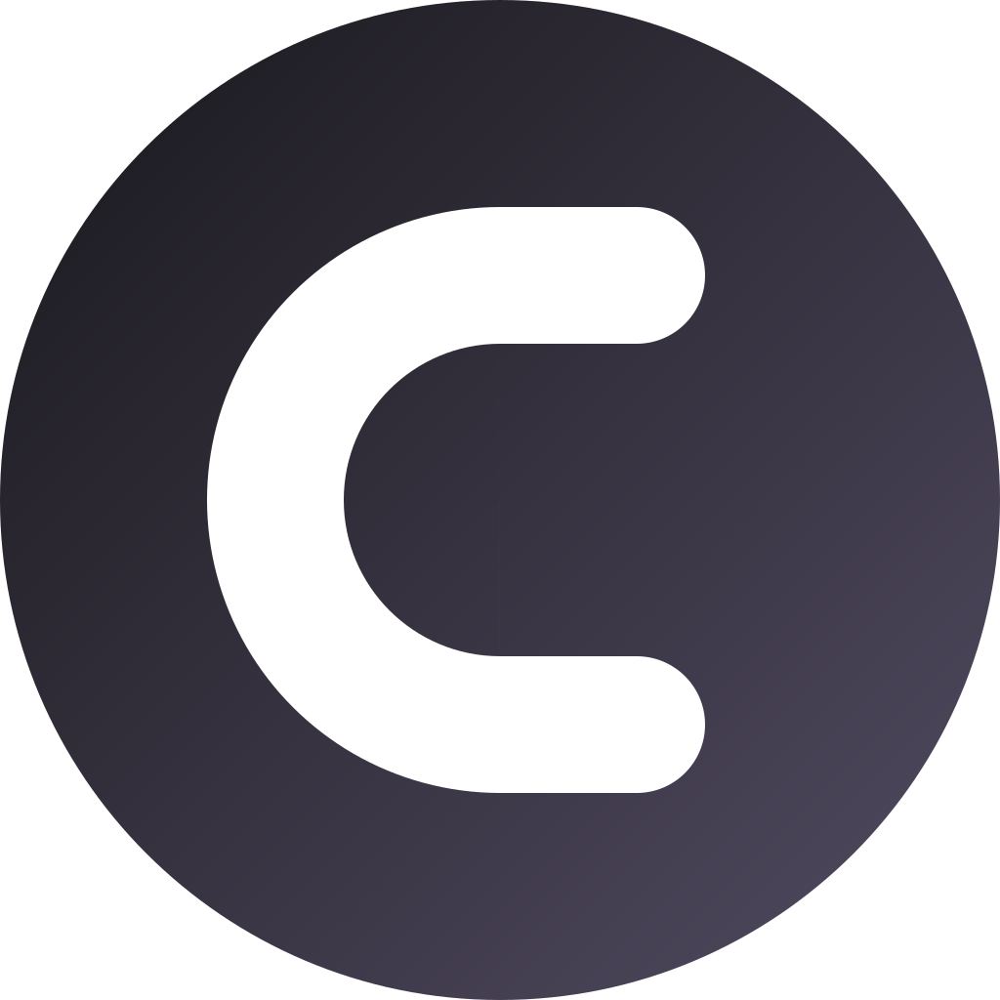
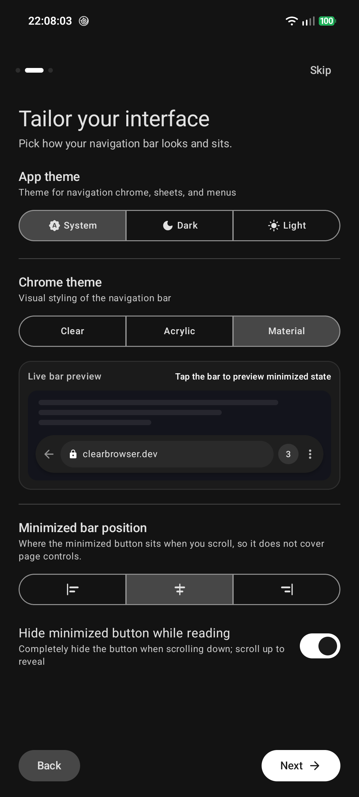

# Clear Browser

<p align="center">
  
</p>

<p align="center">
  <strong>The browser that gets out of your way.</strong>
</p>

<p align="center">
  
  <a href="https://github.com/vylt-gh/clear-browser/releases/latest"></a>
  
  
  
  
</p>

---

**Clear** is a fast, distraction-free web browser for Android designed around a simple principle: **the webpage is the content, the browser is just the tool**. 

Built with Kotlin and Jetpack Compose and powered by Mozilla GeckoView, Clear pre-bundles **uBlock Origin Manifest V2** to strip away intrusive ads, cookie banners, and telemetry before bytes ever hit your screen.

---

## Preview

<p align="center">
  
  &nbsp;
  
  &nbsp;
  
  &nbsp;
  
  &nbsp;
  
</p>
<p align="center">
  <em>Floating Chrome &nbsp;•&nbsp; Anchored Action Menu &nbsp;•&nbsp; Live Bar Preview &nbsp;•&nbsp; Settings & Themes &nbsp;•&nbsp; Library & History</em>
</p>

---

## Why Clear?

### 🛡️ Built-in Desktop-Grade Adblocking
- **Pre-installed uBlock Origin (MV2)**: Active immediately on first launch. Blocks ads, popups, and trackers natively with zero setup.
- **Enhanced Tracking Protection (ETP Strict)**: Built-in Gecko anti-tracking, query parameter stripping, and automatic third-party cookie isolation.
- **Works Everywhere**: Content blocking stays active in both standard and private browsing tabs.

### 📖 Distraction-Free Reading
- **Content-First Interface**: When you scroll down to read, the navigation bar morphs into a subtle corner handle—or vanishes completely when "Hide minimized button while reading" is enabled.
- **Real-Time 120Hz Backdrop Blur**: Smooth, zero-allocation frosted glass blur behind both `Clear` and `Acrylic` chrome themes with multi-pass diffusion and flicker-free temporal EMA blending.
- **Freely Draggable Handle**: Drag the minimized reading handle anywhere along the bottom screen edge for optimal single-handed comfort, with smooth handle-anchored chrome reveal animations.
- **Long-Press Quick Hide**: Long-press the search bar anytime to stash the bar and pop up a temporary dismissible handle.
- **Adaptive Top Bar**: The Android status bar automatically samples and adopts the website's dominant header color for an unbroken, edge-to-edge feel.
- **Live Download Notifications & Canopy Progress**: Real-time progress bar, byte counts, and cancel action right from your notification shade—with an optional slim progress bar running across the top canopy edge while browsing.
- **Find in Page**: Real-time in-page search with match counter (`X of Y`), next/prev controls, and full multi-highlighting.

### 🔒 100% Local, Autofill & Web Capabilities
- **Native Android Autofill Support**: Full compatibility with system autofill managers (1Password, Bitwarden, Keepass, Google) for zero-friction credential saving and login filling.
- **Pin to Home Screen (PWA)**: Pin web apps and pages directly to your Android launcher home screen with high-resolution adaptive icons.
- **Granular & Auto-Accept Site Permissions**: Choose prompt-by-prompt or enable "Auto-accept site permissions" to automatically approve camera, microphone, geolocation, and Web APIs without repetitive dialogs.
- **No Accounts, No Sync Servers**: Your browsing history, bookmarks, and sessions live exclusively on your device.
- **Zero Phone-Home Analytics**: Clear never logs, tracks, or phones home where you browse.
- **Privacy-First Favicons**: Loaded directly from `https://${host}/favicon.ico` without third-party proxy resolvers or remote image proxies.
- **Hard Private Mode**: Ephemeral in-memory sessions that leave zero trace on disk and reset on exit.

### 🚀 Seamless First-Run Walkthrough
- **4-Step Setup Tour**: Choose your search engine (Kagi, DuckDuckGo, Brave, Google, etc.), tailor your interface, grant permissions with one tap, and import data in seconds.
- **App Permissions Setup**: Dedicated permissions screen for download notifications, camera, microphone, and location with one-tap "Grant all" and transparent privacy disclosures.
- **Live Interactive Bar Preview**: Test drive the selected Chrome Theme (`Clear`, `Acrylic`, `Material`), App Theme, and docked position with a tap-to-minimize simulation.
- **One-Tap Default Browser Setup**: Directly trigger Android's native default browser selection prompt (`RoleManager`) with instant checkmark confirmation.
- **HTML Bookmark Import**: Easily bring your existing bookmarks over from Chrome, Firefox, Safari, or desktop browsers via standard HTML bookmark files.

### 🎨 Fully Customizable
- **Independent Theming**: Choose your App Theme (System, Dark, Light) independently from website content theming (`prefers-color-scheme`).
- **3 Navigation Styles**:
  - **Clear** (Default): Translucent frosted glass with specular rim highlights and drop shadow.
  - **Acrylic**: Glassmorphic container with refined outline borders.
  - **Material**: Classic solid Material 3 elevated surface.
- **Ergonomic Docking**: Dock the minimized button to the **Left**, **Center**, or **Right** to suit your thumb reachability.
- **Canopy Pull-to-Refresh**: Natural rubber-band overscroll canopy matched to the active page color with tactile haptic feedback.

### 🧩 Add-ons & WebExtensions
- **Firefox Add-ons Store (AMO)**: Browse and install more extensions directly from `addons.mozilla.org`.
- **Interactive Popups**: WebExtension popups (like uBlock Origin's dashboard and Dark Reader) open seamlessly in a dedicated bottom sheet attached to the active tab.

---

## Download & Installation

### Option 1: Direct APK Download
Grab the latest APK release from the [Releases page](https://github.com/vylt-gh/clear-browser/releases/latest).

### Option 2: Build From Source
**Prerequisites:** JDK 17 or JDK 21, Android SDK platform 37.

```bash
git clone https://github.com/vylt-gh/clear-browser.git
cd clear-browser

# Run unit tests (141 passing tests across 20 test suites)
./gradlew testDebugUnitTest

# Build debug APK
./gradlew assembleDebug

# Install to connected device or emulator
./gradlew installDebug
```

---

## Architecture & Technical Documentation

For developers interested in Clear Browser's engine lifecycle, Choreographer-synchronized scroll rendering, decoupled StateFlow pipelines, and pure Kotlin domain logic:

👉 Read the [Technical Architecture Documentation](docs/ARCHITECTURE.md)

---

## AI Disclosure

This project was developed with the assistance of AI coding agents (Google DeepMind's Antigravity). Architecture, implementation, testing, and documentation were created and refined through interactive pair programming with AI.

---

## License

Clear Browser is open-source software licensed under the [MIT License](LICENSE).
