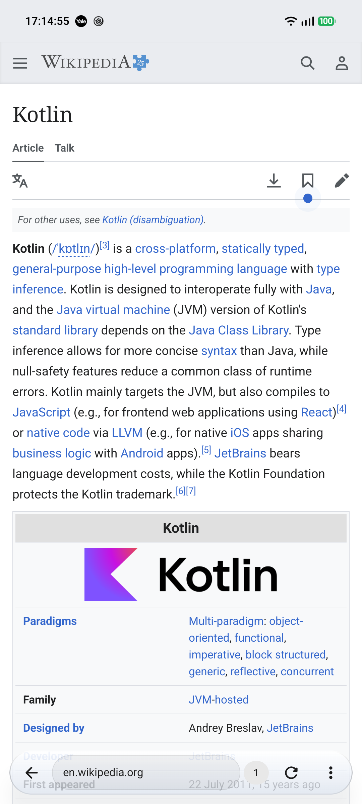
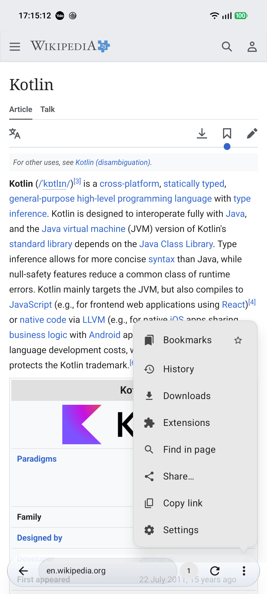
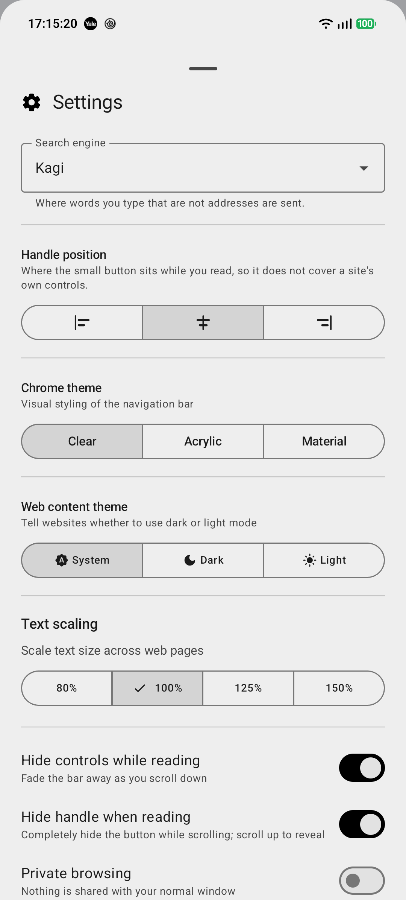
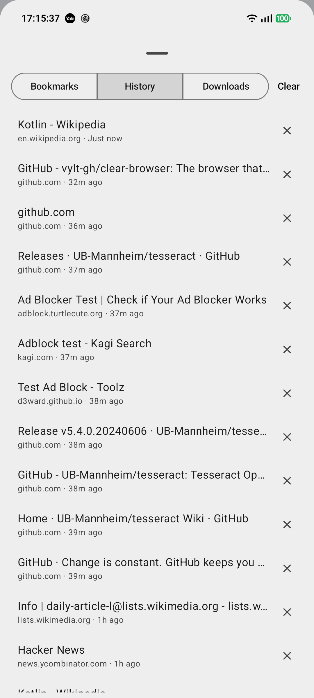
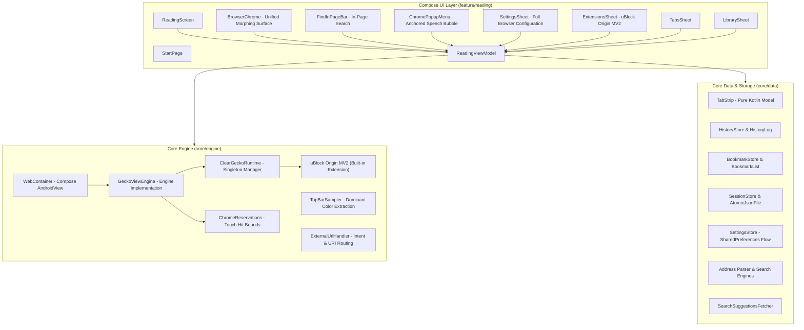

# Clear Browser

<p align="center">
  <strong>The browser that gets out of your way.</strong>
</p>

<p align="center">
  
  
  
  
  
  
  
  
  
</p>

---

**Clear** is an uncluttered, reading-first web browser for Android. Built with **Kotlin**, **Jetpack Compose**, **Material 3 Expressive**, and powered by **Mozilla GeckoView**, Clear bundles **uBlock Origin Manifest V2 (MV2)** to eliminate ads, trackers, and page clutter before they ever reach your screen.

The web page is the content; the chrome is just the tool. When you scroll down to read, the interface gracefully retreats into a minimal corner handle (or fades completely off-screen with "Hide handle when reading"). When you need it, tapping the handle, scrolling upward, reaching the page top, or using the back gesture brings back full navigation controls instantly.

---

## Preview

<p align="center">
  
  &nbsp;&nbsp;
  
  &nbsp;&nbsp;
  
  &nbsp;&nbsp;
  
</p>
<p align="center">
  <em>Maximized Chrome &nbsp;•&nbsp; Anchored Popup Menu &nbsp;•&nbsp; Settings & Themes &nbsp;•&nbsp; Library & History</em>
</p>

---

## Core Philosophy

1. **Content First, Chrome Second**  
   Modern mobile browsers occupy valuable screen real estate with persistent multi-row toolbars, shopping widgets, and recommendation tiles. Clear treats the document as the primary experience: the omnibox and navigation controls auto-hide during reading and animate into a subtle floating corner handle (or retreat completely off-screen when "Hide handle when reading" is enabled). Tapping the handle, scrolling upward, reaching the page top, or using the Android back gesture instantly restores full controls.
2. **Resource-Respecting Architecture**  
   Traditional browsers often keep dozens of browser engine compositor instances running concurrently in the background, consuming hundreds of megabytes of RAM and draining battery. Clear maintains **only one active attached GeckoView instance** in the view hierarchy at a time. Inactive tabs are detached, paused, and restored on-demand.
3. **Hard Isolation for Privacy**  
   Private browsing should be a security guarantee, not a cleanup promise. Clear's Incognito mode uses dedicated ephemeral `GeckoSession` instances (`usePrivateMode(true)`) with isolated in-memory cookie jars, cache, and storage. Private sessions never write to disk and are completely purged when finished.
4. **Local-First & Transparent**  
   No external sync accounts, no telemetry, and no diagnostic tracking by Clear. History and bookmarks are stored strictly on-device in atomic human-readable JSON files with atomic rename operations. When you search or navigate via the address bar, queries are sent directly from your device to your chosen search engine (Kagi by default, or DuckDuckGo, Brave, Google, etc.) with no intermediary proxy or logging servers.

---

## Features

### Built-in Desktop-Grade Adblocking
- **uBlock Origin Manifest V2 (MV2)**: Pre-bundled and active out of the box (`uBlock0@raymondhill.net`). Blocks network requests, third-party trackers, and intrusive ad-tech scripts before bytes ever hit your device.
- **Enhanced Tracking Protection (ETP Strict)**: Native Gecko anti-tracking, query parameter stripping, and automatic third-party cookie purging.
- **Enabled in Private Browsing**: Full content blocking protection extends across both regular and private browsing sessions.

### Minimalist & Responsive Interface
- **Unified Morphing Surface**: Rather than jarringly animating separate toolbars and buttons, the omnibox dynamically morphs into an unobtrusive reveal handle and back using physics-based spring animations (`Motion.kt`).
- **Customizable Handle Position**: Dock the collapsed reveal handle to the **Left**, **Center**, or **Right** of the screen so it never covers in-page elements, chat widgets, or cookie banners.
- **Find in Page**: Dedicated floating search bar with match counter (`X of Y`), forward/backward navigation arrows, and native Gecko multi-highlighting.
- **Web Content Dark Mode**: 3-way toggle (System / Dark / Light) communicating your theme preference directly to websites via CSS `prefers-color-scheme` without requiring page reloads.
- **HTML5 Fullscreen Video**: Native immersive fullscreen for web videos and elements (`onFullScreen`), hiding all system and compose chrome while preserving back gesture control.
- **External App & Intent URI Handling**: Robust routing for `intent://`, `market://`, `mailto:`, `tel:`, and app deep links, with automatic fallback to `browser_fallback_url` or Play Store web.
- **Command & Automation Dispatch**: Control all browser actions (search, tabs, theme, menu, navigation) directly through Android Intent extras for easy testing and automation.
- **Full-Bleed Viewport**: Inset-free web view eliminates layout re-calculation jitter during scrolling, locking to a smooth 120fps display pipeline.
- **Dynamic Theming**: Full Material 3 Expressive theming supporting dynamic wallpaper color extraction (Material You) and system Dark/Light themes.
- **Immersive Mode**: Fullscreen mode option to hide both system navigation and status bars for distraction-free reading.

### Adaptive Top Bar & Notch Integration
- **Dominant Header Color Extraction**: On page load, `TopBarSampler` clusters and quantizes the top region of the webpage using 5-bit color buckets. If a dominant color accounts for $\ge 50\%$ of the header (like Hacker News orange), that exact shade is chosen; otherwise, a weighted average RGB is computed.
- **Seamless Status Bar Extension**: The Android status bar area is filled with the sampled website color, blending seamlessly into the website's navigation header.
- **Notch & Cutout Safe Area**: Web content begins cleanly below the status bar, guaranteeing fixed headers, hamburger menus, and search bars are never obscured by the camera cutout or system clock.
- **Dynamic Status Bar Icon Contrast**: Relative luminance calculation ($L > 0.45$) dynamically toggles light or dark status bar icons (clock, battery, wifi) to maximize readability against any website's color palette.
- **Zero Scroll Overhead**: Sampled once on page load and locked for the duration of the page. Scrolling is 100% free of layout re-calculations, pixel copies, or compositor delays.

### Frosted Glass Aesthetics
- **Seamless Acrylic Styling**: Both the collapsed omnibox pill and the live search suggestions card share a cohesive frosted glass design language with multi-stop vertical acrylic gradients.
- **Specular Rim Highlights**: Gradient specular top rim catch borders reflect light naturally while subtle ambient and spot depth shadows elevate floating controls above the page.
- **Hairline Dividers**: Search suggestions are separated by subtle, translucent hairlines rather than opaque separator blocks.

### Privacy & Incognito
- **Context-Isolated Private Sessions**: Independent memory-only context IDs via GeckoView's private browsing architecture. Cookies, storage, and history are never written to disk.
- **Zero Disk Footprint in Incognito**: Session persistence, download history, and visit logs are completely bypassed in private mode.
- **Subtle Privacy Indicator**: An unobtrusive Material `VisibilityOff` glyph in the address bar confirms private mode without consuming horizontal bar space.
- **Lifecycle Resilience**: Private mode survives Activity configuration changes (screen rotations, font changes) without leaking tabs to the standard profile, but resets completely on application finish.

### Efficient Tab Strip
- **Lazy Engine Allocation**: Tabs restored from previous sessions remain URLs until activated, saving memory and startup latency.
- **Tab Strip Management**: Fast bottom sheet with open tab counts, active tab indicators, single-tap switching, and per-tab closing.
- **Persistent Sessions**: Active tabs, history state, and scroll offsets are saved atomically on app backgrounding, with state bundles preserved across process death.

### Search & Navigation
- **Live Search Suggestions**: Instant debounced query suggestions with local bookmark and history matching. Easily append suggestions directly into the omnibox via `↖`.
- **Kagi by Default**: Ships with privacy-first [Kagi](https://kagi.com) search out of the box, with one-tap configuration for **DuckDuckGo**, **Brave Search**, **Startpage**, **Mojeek**, **Ecosia**, **Google**, and **Bing**.
- **Smart Omnibox Parsing**: Automatic distinction between search queries, IP addresses, `localhost`, and full/short domain names (`Address.kt`).
- **Desktop Site Toggle**: Switch user-agent string per session to request desktop layouts.

### Bookmarks & History
- **Deduplicated History**: Intelligent visit logging that drops transient redirects, strips URL fragments (`#anchors`), and maintains a clean 1,000-entry history.
- **One-Tap Bookmarking**: Instant bookmark toggle from the main menu with a dedicated Bookmarks/History management sheet.
- **Atomic Disk Storage**: Thread-safe, non-blocking disk persistence using temporary files and atomic renames (`AtomicJsonFile.kt`) preventing state corruption.

### Web Engine Integration
- **Mozilla GeckoView Backend**: Robust, modern Gecko web rendering engine with WebRender hardware compositing.
- **Modern Web Permissions**: Clean runtime permission negotiation for Camera, Microphone, and Location.
- **Secure File Uploads**: Android `FileProvider` integration for seamless in-browser file uploads and image captures.
- **Native JavaScript Dialogs**: Custom Material 3 Compose host for JavaScript `alert`, `confirm`, and `prompt` dialogs.
- **RFC-Compliant Downloads**: Proper download filename resolution supporting RFC 5987 / RFC 6266 (`Content-Disposition: filename*`).

---

## Technical Architecture



### Performance Highlights
- **Decoupled Progress State**: GeckoView engine loading progress emits into an independent `StateFlow<Int>`, preventing full-screen UI recompositions during high-frequency (100Hz) page loads.
- **Choreographer-Synchronized Scroll**: Scroll detection synchronizes directly with Android's `Choreographer` display frame pulses, dropping janky frames from 23% to 1.75% and p95 frame rendering latency to 11ms.
- **Tested Pure Domain Logic**: Critical logic (`TabStrip`, `ChromeReservations`, `HistoryLog`, `BookmarkList`, `Address`, `BookmarkCodec`) is written in pure Kotlin with no Android SDK dependencies, allowing millisecond unit testing.

---

## Project Structure

```
clear-browser/
├── app/
│   ├── src/
│   │   ├── main/
│   │   │   ├── AndroidManifest.xml
│   │   │   ├── java/dev/clearbrowser/
│   │   │   │   ├── ClearBrowserApp.kt         # Application entry point
│   │   │   │   ├── MainActivity.kt            # Edge-to-edge host activity
│   │   │   │   ├── MainActivityHost.kt        # Permissions, camera & file intents
│   │   │   │   ├── JsDialogHost.kt            # Compose JS dialog host
│   │   │   │   ├── core/
│   │   │   │   │   ├── data/                  # Storage, settings, address parsing
│   │   │   │   │   ├── engine/                # GeckoView engine, profiles, reservations
│   │   │   │   │   └── theme/                 # M3 color palettes & spring motion
│   │   │   │   └── feature/reading/           # Compose screens, sheets & ViewModel
│   │   │   └── res/                           # Drawables, strings, theme XMLs
│   │   └── test/java/dev/clearbrowser/        # 123 Pure Kotlin unit tests
│   └── build.gradle.kts
├── docs/
│   └── OPEN_ISSUES.md                         # Architecture notes and design records
├── gradle/libs.versions.toml                  # Version catalog
└── README.md
```

---

## Releases & Changelog

### v0.9.0 (Latest)
- **Canopy Pull-to-Refresh**:
  - Natural overscroll physics with rubber-band damping pulling the page header downward.
  - Expanding status bar canopy dynamically matched to the webpage's sampled top bar color (or theme surface on the start page) with a centered spring refresh indicator.
  - Smooth non-blocking reload lifecycle that springs closed with an alpha fade (preventing stuck refresh spinners).
  - Canopy color continuity across navigations and reloads: preserves the previous page color until the new page's top color is extrapolated, eliminating flashes of black.
  - Configurable "Pull to refresh" toggle in the Settings bottom sheet.
- **Privacy-First Favicons & Tab Switcher Icons**:
  - Direct-to-host favicon loading (`https://${host}/favicon.ico`) with zero telemetry, zero logging, and zero third-party proxy lookups (no Google or DuckDuckGo proxy leaks).
  - In-house `FaviconDecoder` & `IcoParser` capable of decoding both standard PNG/WEBP/JPEG and multi-entry Windows `.ico` containers (embedded PNGs and 1-bit, 4-bit, 8-bit, 24-bit, and 32-bit DIB entries with alpha masks) with zero third-party image dependencies.
  - Two-tier caching with in-memory `LruCache` (capacity 60) and persistent disk cache (`cacheDir/favicons/`).
  - Strict private browsing isolation: incognito tabs never read from or write favicons to disk.
  - Redesigned tab row layout with a fixed $32\text{dp}$ guide slot displaying crisp favicons, stylish circular monogram letter badges for sites without icons, and a compass icon for blank/start tabs.
- **Chrome Layout & Themed Tab Button**:
  - Re-proportioned bottom chrome icon layout: increased breathing room between the search pill and action buttons, with uniform $38\text{dp} \times 38\text{dp}$ touch slots and balanced center-to-center spacing between Tabs, Reload, and Menu.
  - Redesigned the tab counter into a perfect $30\text{dp}$ circle with theme-adaptive styling matching `ChromeTheme.CLEAR` (frosted glass surface with specular border), `ACRYLIC`, and `MATERIAL`.
- **Expanded Unit Test Suite**:
  - 123 pure Kotlin unit tests passing across 18 test suites covering pull-to-refresh damping physics, favicon ICO container decoding, DIB pixel unpacking, and host extraction.

### v0.8.0
- **Dynamic Extension Action Popups**: WebExtension popups (such as uBlock Origin's quick controls/dashboard and Dark Reader) now open in a responsive modal bottom sheet attached directly to the active web tab. Features like uBlock's element zapper, picker, and per-site switches interact seamlessly with the live page.
- **Dual Extension Controls**: Each installed extension card in the Extensions sheet now displays separate quick-action and settings buttons:
  - **Popup / Action**: Triggers the extension's interactive popup for the active tab.
  - **Settings**: Opens the extension's full options/dashboard page (`options_ui`).
- **AMO Firefox Add-ons Store Integration**: Direct link in the Extensions sheet to browse `addons.mozilla.org` with native handling for installing extensions directly into Clear Browser.
- **Downloads Tab in Library**: Added dedicated Downloads manager in the Library sheet alongside Bookmarks and History with real-time download status, file sizes, and quick open/share actions.
- **Hierarchical Back Navigation**:
  - The Android back gesture walks back through engine browsing history without prematurely exiting the app.
  - Reaching the first page of a tab navigates cleanly to the start page (`about:blank`) instead of closing the browser.
  - Exiting the app only occurs after backing out from `about:blank`.
  - The toolbar back button dynamically indicates navigation availability.

### v0.7.0
- **Chrome Visual Theming**: Added a 3-way visual chrome style selector in Settings (`Clear`, `Acrylic`, `Material`):
  - **Clear** (Default): Signature frosted glass aesthetic with multi-stop acrylic gradient, specular rim highlight borders, ambient drop shadow, and speech-bubble anchored popup menu.
  - **Acrylic**: Translucent `surfaceContainer` (88%–78% alpha) with `outline` specular gradient border, 8.dp elevation, and standard rounded card popup menu.
  - **Material** (from v0.1): Classic pure solid Material 3 `surfaceContainer` and `surfaceContainerHigh` with no artificial borders or translucent gradients, matching the original v0.1 look.
- **Fixed Handle Alignment & Positioning**: Fixed coordinate calculation bug where centered parent column previously displaced Left, Center, and Right dock positions.
- **Dedicated "Hide Handle When Reading" Toggle**: Added dedicated setting switch to completely hide the collapsed handle while reading without requiring off-screen dock hacks. Scroll up or back-press to reveal the bar.
- **Segmented Chrome Theme Control**: Interactive `SingleChoiceSegmentedButtonRow` embedded seamlessly in the Settings bottom sheet.
- **Intent Automation Dispatch**: Full Intent support for automating the Chrome theme via `--es command chrome_theme --es theme CLEAR|ACRYLIC|MATERIAL`, handle positioning (`--es command position --es position LEFT|CENTER|RIGHT`), and handle hiding (`--es command hide_handle --ez enabled true|false`).

### v0.6.0
- **Share Page & Copy Link**: Added quick sharing via Android standard `ACTION_SEND` chooser and one-tap link copying directly in the anchored popup menu.
- **Granular Clear Browsing Data**: Interactive clearing dialog with selectable checkboxes for browsing history, cookies/site data, and cached web content.
- **Web Text Scaling & Zoom**: Dynamically scale web text sizes (`80%`, `100%`, `125%`, `150%`) across all websites via GeckoView's font size factor.
- **Native Site Permission Prompts**: Prompts for web geolocation, desktop notifications, persistent storage, camera, and microphone permissions.
- **Long-Press Context Menu**: Long-pressing links or images opens a bottom sheet with preview card, "Open in new tab", "Copy link/image address", "Share link", and "Download image".

### v0.5.0
- **Anchored Popup Bubble Menu**: Overflow action menu redesigned as an anchored speech-bubble popup emerging directly above the `⋮` button, matching tactile native ergonomics.
- **Dedicated Settings & Extensions Sheets**: Cleanly organized modal bottom sheets for browser preferences and extension controls.
- **uBlock Origin Dashboard Launcher**: Full WebExtension routing for `moz-extension://` internal schemes, allowing one-tap launching and configuration of uBlock Origin's dashboard and custom filter lists directly in-browser.
- **120Hz Smooth Scrolling for History & Bookmarks**: Zero-allocation relative time formatting via integer math, precomputed display models, and fixed-height rows eliminating ICU/JNI bottlenecks and nested scroll jitter.
- **Expanded Command Intent Dispatch**: Automate navigation, menus, settings, extensions, bookmarks, and history directly via Intent extras (`--es command ...`).

### v0.4.0
- **Dark Mode for Web Content**: 3-option toggle (`System` / `Dark` / `Light`) communicating directly with websites via CSS `prefers-color-scheme` without page reloads.
- **Find in Page**: Real-time in-page search bar with match counter (`X of Y`), forward/backward navigation, auto-focus, and auto-scrolling to active matches.
- **HTML5 Fullscreen Video**: Full support for HTML5 `video.requestFullscreen()` and element fullscreen with automatic status and navigation bar hiding, zero insets, and back-press handling.
- **External App & Intent URI Handling**: Routing for `intent://`, `market://`, `mailto:`, `tel:`, `sms:`, and app deep links with security sanitization and automatic fallback to `browser_fallback_url` or Play Store web.
- **Command & Automation Dispatch**: Control all browser actions (find, theme, menu, tabs, new_tab, navigate) directly via Android Intent extras for easy testing and automation (`adb shell am start -n dev.clearbrowser/.MainActivity --es command ...`).

### v0.3.0
- **Adaptive Site Top Bar**: Dominant color extraction for website headers via `TopBarSampler` and notch safe area integration.
- **Frosted Glass Aesthetics**: Seamless acrylic styling with specular highlights and rim gradients.

### v0.2.0
- **Engine Swap**: Replaced system WebView with Mozilla GeckoView and hardware WebRender compositing.
- **Built-in Adblocking**: Bundled uBlock Origin MV2 (`uBlock0@raymondhill.net`) with strict tracking protection.

### v0.1.0
- **Initial Prototype**: Reading-first morphing omnibox chrome, isolated Incognito sessions, and single-tab detached lifecycle.

---

## Building and Running

### Prerequisites
- **JDK 17** or **JDK 21**
- **Android SDK** with platform 37 installed (`compileSdk = 37`, `compileSdkMinor = 2`, `minSdk = 26`)

### Commands

**1. Clone the repository:**
```bash
git clone https://github.com/vylt-gh/clear-browser.git
cd clear-browser
```

**2. Run unit tests:**
```bash
./gradlew testDebugUnitTest
```

**3. Build the debug APK:**
```bash
./gradlew assembleDebug
```
The output APK is generated at:
`app/build/outputs/apk/debug/app-debug.apk`

**4. Install to a connected device or emulator:**
```bash
./gradlew installDebug
```

---

## Tech Stack & Dependencies

| Component | Technology | Version |
|---|---|---|
| **Language** | Kotlin | 2.3.20 |
| **Build System** | Gradle / Android Gradle Plugin | 9.8.0 / 9.4.1 |
| **UI Toolkit** | Jetpack Compose (BOM) | 2026.09.00 |
| **Design System** | Material 3 Expressive (`material3`) | Latest M3 |
| **Web Engine** | Mozilla GeckoView (`org.mozilla.geckoview`) | 159.0 |
| **Adblocker** | uBlock Origin Manifest V2 (MV2) | 1.75.4 |
| **Architecture** | AndroidX Lifecycle & ViewModel Compose | 2.9.4 |
| **Unit Testing** | JUnit 4 | 4.13.2 |

---

## AI Disclosure

This project was developed with the assistance of AI coding agents (specifically Google DeepMind's Antigravity). Architecture, implementation, testing, and documentation were created, reviewed, and maintained through interactive pair programming with AI.

---

## License

This project is open-source software licensed under the [MIT License](LICENSE).
