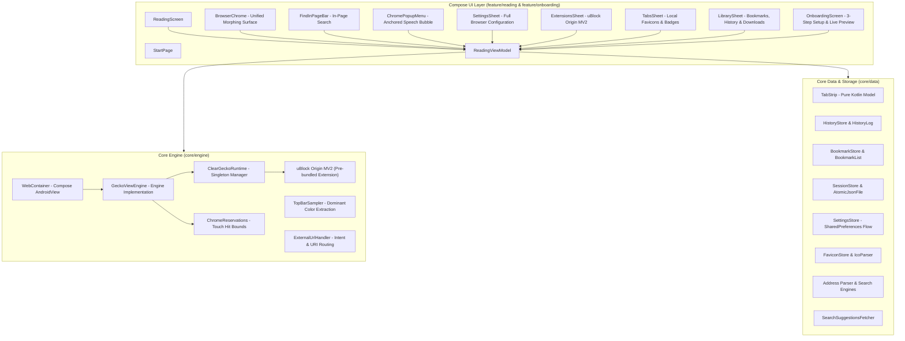

# Clear Browser Technical Architecture & Internals

This document covers the internal design, engineering decisions, performance optimizations, and component architecture of Clear Browser. For general user overview and features, see the [README.md](../README.md).

---

## Architecture Diagram

The browser is architected into three strictly decoupled layers:
1. **Compose UI Layer**: Pure reactive Jetpack Compose presentation layer.
2. **Core Engine**: Wrapper and lifecycle manager around Mozilla GeckoView and native extensions.
3. **Core Data**: Atomic, local-first domain models and file persistence.



---

## Core Subsystems & Technical Details

### 1. Single-Compositor Engine Lifecycle
Unlike traditional browsers that maintain concurrent engine compositors for background tabs (costing hundreds of megabytes of RAM and battery), Clear maintains **only one active attached GeckoView instance** in the view hierarchy at a time:
- Inactive tabs remain lightweight URL references and session states in memory until selected.
- Selecting a tab restores session tokens without spawning background render pipelines.
- Incognito tabs use ephemeral `GeckoSession` instances (`usePrivateMode(true)`) with isolated in-memory cookie jars, cache, and storage that are completely purged on close.

### 2. Motion & Morphing Chrome Surface
- Rather than animating toolbars off-screen, the bottom omnibox morphs between a full-width reading bar and a compact reveal handle using physics-based spring interpolation (`Motion.kt`).
- The reveal handle docks cleanly to the **Left**, **Center**, or **Right** of the screen based on thumb reachability preferences (`ChromePosition`).
- When "Hide minimized button while reading" is enabled, the handle retreats completely off-screen during downward scroll and springs back on upward scroll or edge back gesture.

### 3. Adaptive Canopy & Top Bar Color Sampling
- **Dominant Header Sampling**: On page load, `TopBarSampler` samples and clusters the top region of the webpage using 5-bit color buckets. If a dominant color accounts for $\ge 50\%$ of the header, that exact shade is applied to the system status bar; otherwise, a weighted average RGB is computed.
- **Canopy Pull-to-Refresh**: Overscrolling downward reveals an expanding top canopy smoothly color-matched to the page's top bar color with rubber-band damping physics and a spring refresh indicator.
- **Color Continuity**: During navigations and reloads, the previous top bar color is preserved until the incoming page's color is sampled, preventing jarring flashes of black or white.

### 4. Zero-Telemetry Local Favicon Engine
- Favicons are fetched directly from `https://${host}/favicon.ico` without third-party proxy resolvers or remote lookups (preventing external tracking leaks).
- **Pure Kotlin Decoder (`FaviconDecoder` & `IcoParser`)**: Decodes standard PNG/WEBP/JPEG and multi-entry Windows `.ico` containers (supporting 1-bit, 4-bit, 8-bit, 24-bit, and 32-bit DIB bitmaps with alpha masks) with zero external image dependencies.
- **Two-Tier Cache**: In-memory `LruCache` (60 items) for instant tab switcher rendering, backed by persistent disk caching (`cacheDir/favicons/`). Private browsing tabs are strictly isolated from disk cache.

### 5. Atomic Disk Storage & Interoperability
- Thread-safe, non-blocking disk persistence using temporary files and atomic rename operations (`AtomicJsonFile.kt`), preventing state corruption across unexpected process termination.
- **Bookmark Interoperability**: `BookmarkCodec` supports importing and exporting standard Netscape Bookmark HTML format (`<!DOCTYPE NETSCAPE-Bookmark-file-1>`), compatible with Chrome, Firefox, Brave, Safari, and desktop browsers.

---

## Performance Optimizations

1. **Decoupled Progress State**:
   High-frequency page loading progress (emitting up to 100Hz) emits to an independent `StateFlow<Int>`, completely isolating rapid progress ticks from the main reading screen state and eliminating full-screen recompositions.
2. **Choreographer-Synchronized Scroll Detection**:
   Scroll intent detection synchronizes with Android's `Choreographer` display frame pulses rather than fixed-timer polling. This dropped janky frames from 23% to 1.75% and reduced p95 frame rendering latency to 11ms.
3. **120Hz Smooth Scrolling for History & Bookmarks**:
   Zero-allocation relative time formatting via integer math, precomputed display models, and fixed-height rows, eliminating ICU/JNI bottlenecks during fast flings.
4. **Tested Pure Domain Logic**:
   Critical domain logic (`TabStrip`, `ChromeReservations`, `HistoryLog`, `BookmarkList`, `Address`, `BookmarkCodec`, `FaviconDecoder`) is written in pure Kotlin with zero Android SDK dependencies, allowing millisecond unit testing.

---

## Project Structure

```
clear-browser/
├── app/
│   ├── src/
│   │   ├── main/
│   │   │   ├── AndroidManifest.xml
│   │   │   ├── java/dev/clearbrowser/
│   │   │   │   ├── ClearBrowserApp.kt         # Application entry point & dependencies
│   │   │   │   ├── MainActivity.kt            # Edge-to-edge host activity & role handling
│   │   │   │   ├── MainActivityHost.kt        # Permissions, camera & file intents
│   │   │   │   ├── JsDialogHost.kt            # Material 3 JS dialog host
│   │   │   │   ├── core/
│   │   │   │   │   ├── data/                  # Storage, settings, favicons, address parsing
│   │   │   │   │   ├── engine/                # GeckoView engine, profiles, reservations, pull-to-refresh
│   │   │   │   │   └── theme/                 # M3 color palettes, typography & spring motion
│   │   │   │   └── feature/
│   │   │   │       ├── onboarding/            # 3-step first-run walkthrough & live preview
│   │   │   │       └── reading/               # Compose screens, sheets, chrome & ViewModel
│   │   │   └── res/                           # Multi-density drawables, strings, theme XMLs
│   │   └── test/java/dev/clearbrowser/        # 128 pure Kotlin unit tests
│   └── build.gradle.kts
├── docs/
│   ├── ARCHITECTURE.md                        # Technical architecture & internals (this file)
│   └── OPEN_ISSUES.md                         # Architecture notes, performance tracking & changelog
├── gradle/libs.versions.toml                  # Version catalog
└── README.md                                  # User-facing overview, features & install guide
```
